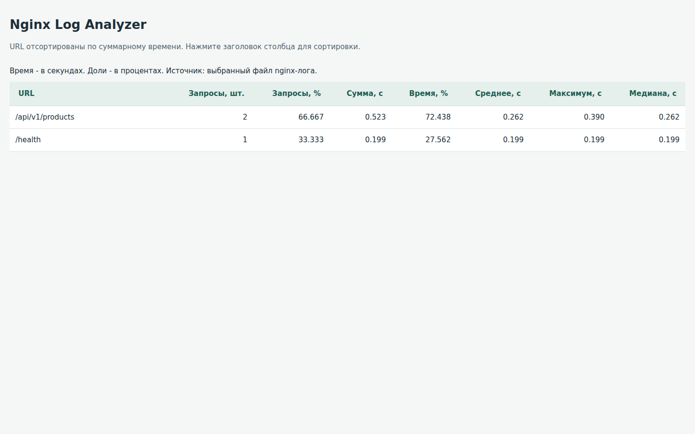

# Nginx Log Analyzer

CLI-инструмент для анализа nginx access-логов. Находит последний лог по дате в
имени, группирует запросы по URL и создаёт автономный HTML-отчёт: число запросов,
доли, суммарное, среднее, максимальное и медианное время ответа.

Проект выделен из собственного решения учебного задания курса OTUS
«Python-разработчик. Продвинутый уровень». Исходное решение доступно в
[учебном репозитории](https://github.com/molodoinatrape/OTUS-Pro/tree/main/homeworks/01_log_analyzer).
В этой версии добавлены самостоятельное оформление, синтетический пример и отчёт
без внешних библиотек JavaScript. Учебное происхождение не означает коммерческий опыт.



## Быстрый старт

Нужны Python 3.14 и uv. Из корня проекта:

```bash
uv sync --locked
uv run log-analyzer --config config.logging.json
```

Откройте `reports/report-2017.06.29.html` в браузере. Файл `report.js` должен лежать
рядом; сеть и локальный web-сервер не нужны. Заголовки столбцов сортируют таблицу.
Синтетический вход находится в `tests/sample/`, журнал - в `logs/analyzer.jsonl`.
Готовый пример отчёта также находится в `examples/report-2017.06.29.html`.

Проверки (для Make-команд нужен GNU Make):

```bash
make lint
make test
```

На Windows без GNU Make:

```powershell
uv run isort --check-only log_analyzer.py tests
uv run black --check log_analyzer.py tests
uv run flake8 log_analyzer.py tests
uv run mypy log_analyzer.py
uv run pytest -q
```

Дополнительно: `make coverage` выводит покрытие. Точные версии зависимостей
закреплены в `uv.lock`. Workflow `.github/workflows/checks.yml` выполняет эти
проверки из корня отдельного проекта; на GitHub новая версия пока не запускалась.

Локальная проверка 2026-11-01: 27 тестов, isort, Black, Flake8 и mypy прошли.
Собраны wheel и sdist; wheel установлен в отдельное окружение и запущен вне
исходной папки. Сортировка HTML-отчёта проверена в Chromium без доступа к сети.

## Свои логи

Скопируйте файлы в `logs/`. Формат имени:
`nginx-access-ui.log-YYYYMMDD` или `nginx-access-ui.log-YYYYMMDD.gz`.
При одинаковой дате выбирается несжатый файл. Из строки берётся URL запроса в
кавычках и время обработки из последнего поля. Другие nginx log_format требуют
адаптации parser.

```json
{
  "LOG_DIR": "logs",
  "REPORT_DIR": "reports",
  "REPORT_SIZE": 1000,
  "PARSE_ERROR_THRESHOLD": 0.5
}
```

```bash
uv run log-analyzer --config config.json
```

Пути в конфигурации отсчитываются от текущего рабочего каталога. `REPORT_SIZE`
ограничивает число URL в отчёте. Порог ошибок - доля от 0 до 1; при превышении
отчёт не создаётся. Неизвестные параметры и неверные типы отклоняются.

Существующий отчёт той же даты не перезаписывается. Для пересчёта задайте новый
`REPORT_DIR` или самостоятельно удалите старый отчёт. HTML записывается через
временный файл. Код завершения: 0 - успех, отсутствие логов или готовый отчёт;
1 - ошибка обработки; 2 - ошибка аргументов CLI.

Не используйте реальные клиентские логи для публичной демонстрации: query string
может содержать контакты и токены. В поставляемом примере - вымышленные URL и IP
из диапазона для документации.

## Сборка и Docker

```bash
uv build
# Установка полученного wheel в отдельное окружение:
python -m pip install dist/nginx_log_analyzer-0.1.0-py3-none-any.whl
log-analyzer --help
```

Дистрибутив включает Python-модуль и HTML/JS-ресурсы. После установки команду можно
запускать вне исходной папки, передав свою конфигурацию.

Альтернативный запуск, если установлен Docker Compose:

```bash
docker compose run --build --rm analyzer
```

Входной demo-лог подключается только для чтения, результат сохраняется в
`reports/docker/`. Контейнерный запуск этой локальной версии отдельно не проверен.

## Как устроена обработка

`read_config` → `validate_overrides` → `find_latest_log` → `iter_logs` →
`group_endpoints` → `build_statistics` → `render_report` → `write_report`.

Чтение файла ленивое, но все времена запросов сохраняются для точной медианы.
Потребление памяти растёт с числом успешно разобранных строк. Это пакетная
обработка локального файла, не потоковый мониторинг сервера.

Для демонстрации объясните, почему строки с ошибками учитываются отдельно,
чем медиана отличается от среднего и зачем HTML сначала пишется во временный файл.
Вопросы и небольшая самостоятельная задача - в [docs/walkthrough.md](docs/walkthrough.md).

## Проверенная версия

[Команды, результаты и границы локальной проверки](docs/verification.md).

[Как получены скриншоты](docs/screenshots.md).
